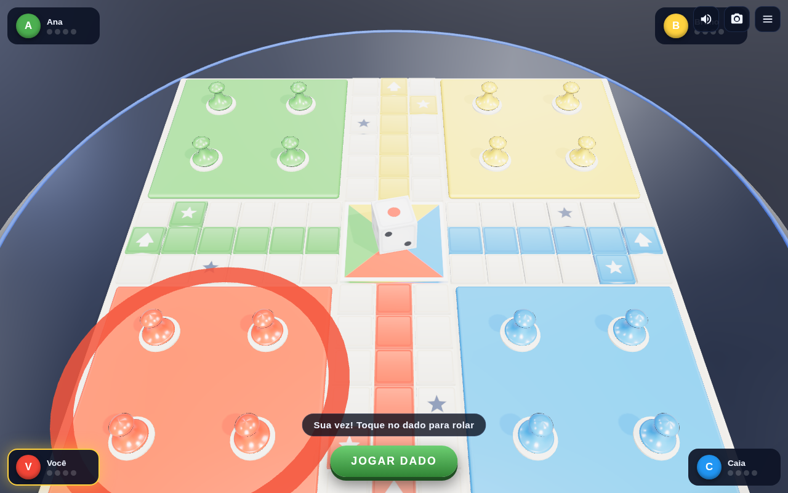

# LUDO 3D

Jogo de Ludo tridimensional realista, inspirado no design do **Ludo King / Ludo Master**, feito com **Three.js + TypeScript** e dado com **física real** (cannon-es) rolando solto no centro do tabuleiro — sem copo.

**Jogar agora (web):** https://carsaimz.github.io/ludo3d/



## Destaques

- Tabuleiro 3D no estilo Ludo King: casas biseladas e brilhantes, 4 bases coloridas, casas seguras com estrela, setas de entrada e triângulos centrais
- Peças clássicas de Ludo modeladas por revolução (LatheGeometry) com material verniz (clearcoat) e sombras suaves
- Dado físico: rola com impulsos aleatórios, quica nas paredes invisíveis da área central e assenta na face do resultado (resultado pré-determinado por seed — pronto para sincronização online)
- Câmera cinematográfica: intro com órbita, enquadramento lateral por jogador, aproximação ao dado, acompanhamento da peça durante o movimento e órbita de celebração na vitória — com órbita livre (arrastar/zoom) a qualquer momento
- Regras clássicas completas: sai da base com 6, jogada extra ao tirar 6 / capturar / chegar, três 6 seguidos queimam a vez, casas seguras, pilhas-bloco, chegada com número exato
- Modos: **Contra o CPU** (2-4 jogadores, com IA heurística) e **Passar e jogar** local (2-4)
- HUD estilo Ludo King: cartões nos cantos com avatar, dado e progresso; avisos, dica central e botão grande de rolagem
- Efeitos sonoros sintetizados via WebAudio (sem assets externos) e confete na vitória
- Motor de regras puro e testado: **19 testes unitários** (vitest)

## Como jogar

- Objetivo: levar as 4 peças até o centro antes dos adversários
- Só sai da base com um 6 — e o 6 dá jogada extra
- Capturar peça adversária (caindo sobre ela) devolve-a à base e dá jogada extra
- Casas com estrela e casas de partida protegem contra captura; duas ou mais peças da mesma forma um bloco que não pode ser ultrapassado por aterrissagem
- Três 6 seguidos: perde a vez
- Para entrar no centro é preciso número exato no dado

## Tecnologias

| Camada | Tecnologia |
| --- | --- |
| Renderização | Three.js 0.169 (WebGL, PBR, sombras PCFSoft) |
| Física do dado | cannon-es |
| Motor de regras | TypeScript puro (sem dependências), testado com Vitest |
| Build | Vite 5 |
| Mobile | Capacitor 7 (`com.ludo3d`, app "LUDO 3D") |
| Desktop | Electron + electron-builder (dmg, NSIS/portable, AppImage) |
| CI/CD | GitHub Actions (CI, Pages, Release) |

## Rodar localmente

```bash
npm install
npm run dev        # servidor de desenvolvimento
npm test           # testes do motor de regras
npm run build      # build de produção em dist/
npm run preview    # servir o build
```

## Empacotamento

### Android (Capacitor)

```bash
npm run build
npx cap add android   # primeira vez
npx cap sync android
cd android && ./gradlew assembleDebug   # APK instalável em android/app/build/outputs/apk/debug/
```

### Desktop (Electron)

```bash
npm run build
npx electron-builder --linux   # ou --mac / --win
```

## Estrutura

```
src/
  engine/    motor de regras puro (tabuleiro, movimentos, IA, RNG com seed)
  render/    cena, tabuleiro, peças, dado físico, câmera, efeitos
  ui/        HUD, menus, ícones
  game.ts    controlador (liga motor, cena, UI e som)
  main.ts    bootstrap e loop principal
```

## Roadmap

- Multiplayer online P2P (WebRTC, host autoritativo) reaproveitando o RNG com seed
- Temas de tabuleiro e skins de peças
- Mais idiomas (hoje: português)

## Licença

MIT — veja [LICENSE](LICENSE).
